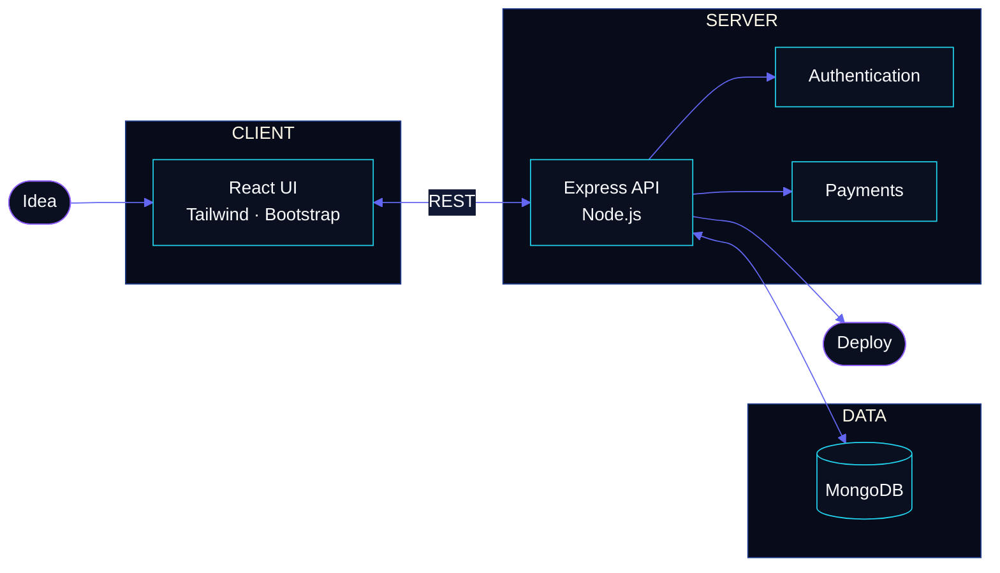

<!-- ╔════════════════════════════════════════════════════════════════════════╗ -->
<!-- ║  SIDDHARTH SHUKLA · PROFILE README · SINGLE FILE · v4 DESIGNER EDITION  ║ -->
<!-- ║  Palette  #020617 ink · #0B1020 card · #1E3A8A royal · #22D3EE cyan     ║ -->
<!-- ║           #6366F1 indigo · #8B5CF6 violet · #CBD5E1 text                ║ -->
<!-- ╚════════════════════════════════════════════════════════════════════════╝ -->

<!-- ═══════════════════════════ HERO ═══════════════════════════ -->
<div align="center">
  
</div>

<div align="center">
  <a href="https://www.siddharthshukla.tech/">
    
  </a>
</div>

<br>

<!-- ═══════════════════════════ NAV ═══════════════════════════ -->
<div align="center">
  <a href="#about"></a>
  <a href="#projects"></a>
  <a href="#architecture"></a>
  <a href="#stack"></a>
  <a href="#activity"></a>
  <a href="#connect"></a>
</div>

<br>

<!-- ═══════════════════════════ SOCIAL + LIVE BADGES ═══════════════════════════ -->
<div align="center">
  <a href="https://www.siddharthshukla.tech/"></a>
  <a href="https://linkedin.com/in/siddharth-shukla-811302272"></a>
  <a href="mailto:siddsanskshukla@gmail.com"></a>
  <a href="https://twitter.com/sansksidd"></a>
  <br>
  
  
</div>

<br>

<!-- ═══════════════════════════ BENTO GRID ═══════════════════════════ -->
<table align="center" width="100%">
  <tr>
    <td rowspan="2" width="44%" valign="top">
      <sub><b>◆ CURRENTLY BUILDING</b></sub>
      <h2>Wanderlust</h2>
      <p>A full-stack hotel booking platform: authentication, property management, reviews and payments.</p>
      <a href="https://github.com/siddshukla/MajorProject"></a>
    </td>
    <td width="28%" valign="top">
      <sub><b>◆ LEARNING</b></sub>
      <h4>System Design &amp; Cloud</h4>
      <sub>Advanced DBMS · Architecture</sub>
    </td>
    <td width="28%" valign="top">
      <sub><b>◆ AVAILABILITY</b></sub>
      <h4>Open to work</h4>
      <sub>Roles · Internships · Collabs</sub>
    </td>
  </tr>
  <tr>
    <td valign="top">
      <sub><b>◆ CORE STACK</b></sub>
      <h4>MERN</h4>
      <sub>MongoDB · Express · React · Node</sub>
    </td>
    <td valign="top">
      <sub><b>◆ FOCUS</b></sub>
      <h4>Scalable &amp; clean</h4>
      <sub>Architecture · UI · Performance</sub>
    </td>
  </tr>
</table>

<br>

<!-- ═══════════════════════════ 01 · ABOUT ═══════════════════════════ -->
<a id="about"></a>


<br>

<div align="center">
  
</div>

```text
siddharth@dev ~ $ neofetch
────────────────────────────────────────────────────────
  name        Siddharth Shukla
  role        Full-Stack Developer
  stack       MongoDB · Express · React · Node.js
  languages   Java · C · JavaScript · HTML · CSS
  database    MongoDB · SQL
  tools       Git · GitHub · Postman · VS Code
  building    Wanderlust — hotel booking platform
  learning    System Design · Cloud · Advanced DBMS
  status      ● open to opportunities
  contact     siddsanskshukla@gmail.com
────────────────────────────────────────────────────────
```

> [!TIP]
> I care about the full journey of a product: data model, API design, interface polish and deployment. If you are hiring or building something ambitious, let's talk.

<br>

<!-- ═══════════════════════════ 02 · PROJECTS ═══════════════════════════ -->
<a id="projects"></a>


<br>

<table>
  <!-- ── 01 · WANDERLUST ── -->
  <tr>
    <td width="48%" valign="middle">
      <a href="https://github.com/siddshukla/MajorProject">
        
      </a>
    </td>
    <td width="52%" valign="middle">
      
      <h2>Wanderlust</h2>
      <p>A complete hotel booking platform with secure authentication, property management, reviews and payment integration.</p>
      
      
      
      
      <br><br>
      <a href="https://wanderlust-demo.vercel.app"></a>
      <a href="https://github.com/siddshukla/MajorProject"></a>
    </td>
  </tr>
  <!-- ── 02 · BLOGNOVA ── -->
  <tr>
    <td width="52%" valign="middle">
      
      <h2>BlogNova</h2>
      <p>A modern blogging platform with user accounts, content management, a commenting system and a fully responsive interface.</p>
      
      
      
      
      <br><br>
      <a href="https://blognova.onrender.com/"></a>
      <a href="https://github.com/siddshukla/BlogNovaSite"></a>
    </td>
    <td width="48%" valign="middle">
      <a href="https://github.com/siddshukla/BlogNovaSite">
        
      </a>
    </td>
  </tr>
  <!-- ── 03 · PORTFOLIO ── -->
  <tr>
    <td width="48%" valign="middle">
      <a href="https://github.com/siddshukla/portfolio">
        
      </a>
    </td>
    <td width="52%" valign="middle">
      
      <h2>Personal Portfolio</h2>
      <p>A responsive portfolio with fluid motion design, project showcases and a polished contact experience.</p>
      
      
      
      <br><br>
      <a href="https://www.siddharthshukla.tech/"></a>
      <a href="https://github.com/siddshukla/portfolio"></a>
    </td>
  </tr>
</table>

<!-- Live repo cards (pull stars, forks and language straight from GitHub) -->
<div align="center">
  <a href="https://github.com/siddshukla/MajorProject"></a>
  <a href="https://github.com/siddshukla/BlogNovaSite"></a>
  <a href="https://github.com/siddshukla/portfolio"></a>
</div>

<br>

<!-- ═══════════════════════════ 03 · ARCHITECTURE ═══════════════════════════ -->
<a id="architecture"></a>


<br>



<br>

<!-- ═══════════════════════════ 04 · STACK ═══════════════════════════ -->
<a id="stack"></a>


<br>

<table align="center" width="100%">
  <tr>
    <td align="center" width="25%" valign="top">
      <sub><b>LANGUAGES</b></sub><br><br>
      
    </td>
    <td align="center" width="25%" valign="top">
      <sub><b>FRAMEWORKS</b></sub><br><br>
      
    </td>
    <td align="center" width="25%" valign="top">
      <sub><b>DATABASES</b></sub><br><br>
      
    </td>
    <td align="center" width="25%" valign="top">
      <sub><b>TOOLS</b></sub><br><br>
      
    </td>
  </tr>
</table>

<details>
<summary><b>Computer science foundations &amp; engineering practice</b></summary>
<br>

<table width="100%">
  <tr>
    <td width="50%" valign="top">
      <sub><b>CS FOUNDATIONS</b></sub><br><br>
      
      
      
      
      
      
    </td>
    <td width="50%" valign="top">
      <sub><b>ENGINEERING PRACTICE</b></sub><br><br>
      
      
      
      
    </td>
  </tr>
</table>

</details>

<br>

<!-- ═══════════════════════════ 05 · ACTIVITY ═══════════════════════════ -->
<a id="activity"></a>


<br>

<div align="center">

  <!-- Stats · languages (donut) -->
  
  

  <br><br>

  <!-- Streak -->
  

  <br><br>

  <!-- Animated 3D contribution bars -->
  

  <br><br>

  <!-- Contribution area graph -->
  

  <br><br>

  <!-- Trophies -->
  

</div>

<br>

<!-- ═══════════════════════════ 06 · CONNECT ═══════════════════════════ -->
<a id="connect"></a>


<br>

<div align="center">
  
  <br><br>
  <a href="https://www.siddharthshukla.tech/"></a>
  <a href="mailto:siddsanskshukla@gmail.com"></a>
  <a href="https://linkedin.com/in/siddharth-shukla-811302272"></a>
</div>

<!-- ═══════════════════════════ FOOTER ═══════════════════════════ -->

