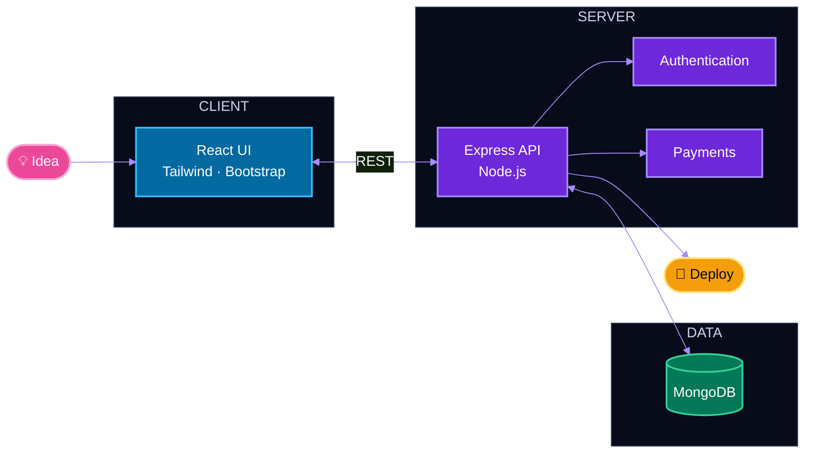
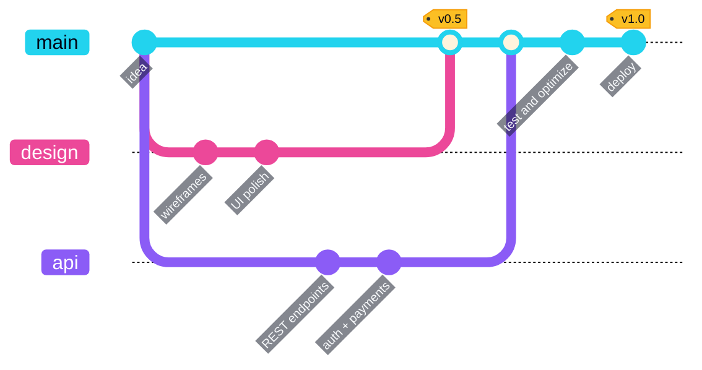

<!-- ╔══════════════════════════════════════════════════════════════════════════╗ -->
<!-- ║  SIDDHARTH SHUKLA · PROFILE README · SINGLE FILE · v5 AURORA EDITION      ║ -->
<!-- ║  Base  #020617 ink  #0B1020 card                                          ║ -->
<!-- ║  Spectrum  #22D3EE cyan · #3B82F6 blue · #8B5CF6 violet · #EC4899 pink    ║ -->
<!-- ║            #F43F5E rose · #F97316 orange · #F59E0B amber · #10B981 green  ║ -->
<!-- ╚══════════════════════════════════════════════════════════════════════════╝ -->

<!-- ═══════════════════════════ HERO · AURORA ═══════════════════════════ -->
<div align="center">
  
  
</div>

<div align="center">
  <a href="https://www.siddharthshukla.tech/">
    
  </a>
</div>

<br>

<!-- ═══════════════════════════ NAV ═══════════════════════════ -->
<div align="center">
  <a href="#about"></a>
  <a href="#projects"></a>
  <a href="#workflow"></a>
  <a href="#stack"></a>
  <a href="#activity"></a>
  <a href="#connect"></a>
</div>

<br>

<!-- ═══════════════════════════ SOCIALS ═══════════════════════════ -->
<div align="center">
  <a href="https://www.siddharthshukla.tech/"></a>
  <a href="https://linkedin.com/in/siddharth-shukla-811302272"></a>
  <a href="mailto:siddsanskshukla@gmail.com"></a>
  <a href="https://twitter.com/sansksidd"></a>
  <br>
  
  
</div>

<br>

<!-- ═══════════════════════════ BENTO GRID ═══════════════════════════ -->
<table align="center" width="100%">
  <tr>
    <td rowspan="2" width="44%" valign="top">
      
      <h2>Wanderlust</h2>
      <p>A full-stack hotel booking platform: authentication, property management, reviews and payments.</p>
      <a href="https://github.com/siddshukla/MajorProject"></a>
    </td>
    <td width="28%" valign="top">
      
      <h4>System Design &amp; Cloud</h4>
      <sub>Advanced DBMS · Architecture</sub>
    </td>
    <td width="28%" valign="top">
      
      <h4>Open to work</h4>
      <sub>Roles · Internships · Collabs</sub>
    </td>
  </tr>
  <tr>
    <td valign="top">
      
      <h4>MERN</h4>
      <sub>MongoDB · Express · React · Node</sub>
    </td>
    <td valign="top">
      
      <h4>Scalable &amp; clean</h4>
      <sub>Architecture · UI · Performance</sub>
    </td>
  </tr>
</table>

<br>

<!-- ═══════════════════════════ 01 · ABOUT (violet → pink) ═══════════════════════════ -->
<a id="about"></a>


<br>

<div align="center">
  
</div>

```ts
// siddharth.config.ts
const developer = {
  name:        "Siddharth Shukla",
  role:        "Full-Stack Developer",
  stack:       ["MongoDB", "Express", "React", "Node.js"],
  languages:   ["Java", "C", "JavaScript", "HTML", "CSS"],
  databases:   ["MongoDB", "SQL"],
  tools:       ["Git", "GitHub", "Postman", "VS Code"],
  building:    "Wanderlust — hotel booking platform",
  learning:    ["System Design", "Cloud Architecture", "Advanced DBMS"],
  principles:  ["Ship with quality", "Obsess over details", "Keep learning"],
  openToWork:  true,
  contact:     "siddsanskshukla@gmail.com",
} as const;
```

> [!TIP]
> I care about the full journey of a product: data model, API design, interface polish and deployment. If you are hiring or building something ambitious, let's talk.

<br>

<!-- ═══════════════════════════ 02 · PROJECTS (rose → orange) ═══════════════════════════ -->
<a id="projects"></a>


<br>

<table>
  <!-- ── 01 · WANDERLUST · rose ── -->
  <tr>
    <td width="48%" valign="middle">
      <a href="https://github.com/siddshukla/MajorProject">
        
      </a>
    </td>
    <td width="52%" valign="middle">
      
      <h2>Wanderlust</h2>
      <p>A complete hotel booking platform with secure authentication, property management, reviews and payment integration.</p>
      
      
      
      
      <br><br>
      <a href="https://wanderlust-demo.vercel.app"></a>
      <a href="https://github.com/siddshukla/MajorProject"></a>
    </td>
  </tr>
  <!-- ── 02 · BLOGNOVA · violet ── -->
  <tr>
    <td width="52%" valign="middle">
      
      <h2>BlogNova</h2>
      <p>A modern blogging platform with user accounts, content management, a commenting system and a fully responsive interface.</p>
      
      
      
      
      <br><br>
      <a href="https://blognova.onrender.com/"></a>
      <a href="https://github.com/siddshukla/BlogNovaSite"></a>
    </td>
    <td width="48%" valign="middle">
      <a href="https://github.com/siddshukla/BlogNovaSite">
        
      </a>
    </td>
  </tr>
  <!-- ── 03 · PORTFOLIO · emerald ── -->
  <tr>
    <td width="48%" valign="middle">
      <a href="https://github.com/siddshukla/portfolio">
        
      </a>
    </td>
    <td width="52%" valign="middle">
      
      <h2>Personal Portfolio</h2>
      <p>A responsive portfolio with fluid motion design, project showcases and a polished contact experience.</p>
      
      
      
      <br><br>
      <a href="https://www.siddharthshukla.tech/"></a>
      <a href="https://github.com/siddshukla/portfolio"></a>
    </td>
  </tr>
</table>

<!-- Live repo cards · one accent per project -->
<div align="center">
  <a href="https://github.com/siddshukla/MajorProject"></a>
  <a href="https://github.com/siddshukla/BlogNovaSite"></a>
  <a href="https://github.com/siddshukla/portfolio"></a>
</div>

<br>

<!-- ═══════════════════════════ 03 · WORKFLOW (emerald → cyan) ═══════════════════════════ -->
<a id="workflow"></a>


<br>

**System architecture**



**Delivery workflow**



<br>

<!-- ═══════════════════════════ 04 · STACK (amber → orange → pink) ═══════════════════════════ -->
<a id="stack"></a>


<br>

<table align="center" width="100%">
  <tr>
    <td align="center" width="25%" valign="top">
      <br><br>
      
    </td>
    <td align="center" width="25%" valign="top">
      <br><br>
      
    </td>
    <td align="center" width="25%" valign="top">
      <br><br>
      
    </td>
    <td align="center" width="25%" valign="top">
      <br><br>
      
    </td>
  </tr>
</table>

<details>
<summary><b>Computer science foundations &amp; engineering practice</b></summary>
<br>

<table width="100%">
  <tr>
    <td width="50%" valign="top">
      <br><br>
      
      
      
      
      
      
    </td>
    <td width="50%" valign="top">
      <br><br>
      
      
      
      
    </td>
  </tr>
</table>

</details>

<br>

<!-- ═══════════════════════════ 05 · ACTIVITY (pink → violet → cyan) ═══════════════════════════ -->
<a id="activity"></a>


<br>

<div align="center">

  <!-- Stats (pink) + Languages donut (amber) -->
  
  

  <br><br>

  <!-- Streak (cyan ring · pink fire) -->
  

  <br><br>

  <!-- Animated 3D contribution bars -->
  

  <br><br>

  <!-- Contribution area graph -->
  

  <br><br>

  <!-- Trophies -->
  

</div>

<br>

<!-- ═══════════════════════════ 06 · CONNECT (green → cyan → blue) ═══════════════════════════ -->
<a id="connect"></a>


<br>

<div align="center">
  
  <br><br>
  <a href="https://www.siddharthshukla.tech/"></a>
  <a href="mailto:siddsanskshukla@gmail.com"></a>
  <a href="https://linkedin.com/in/siddharth-shukla-811302272"></a>
</div>

<!-- ═══════════════════════════ FOOTER · AURORA ═══════════════════════════ -->


